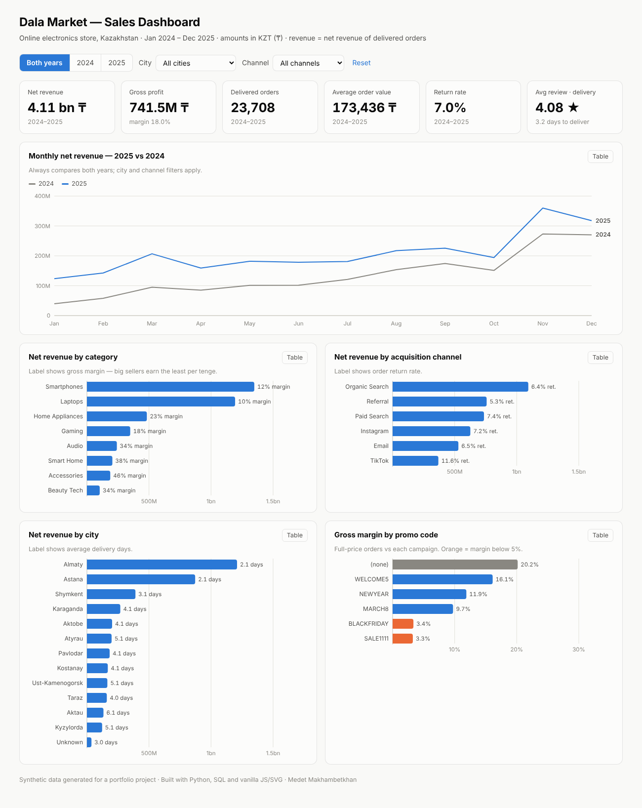
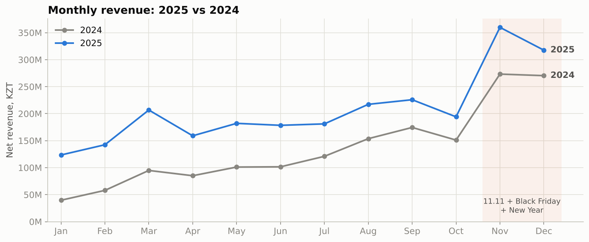
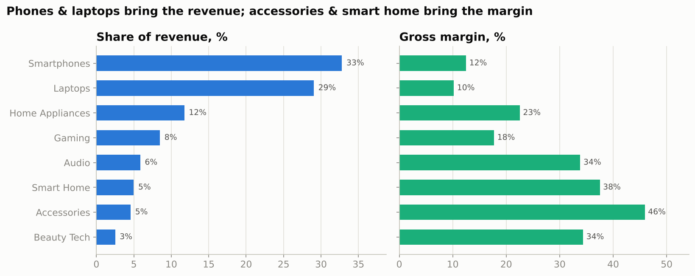
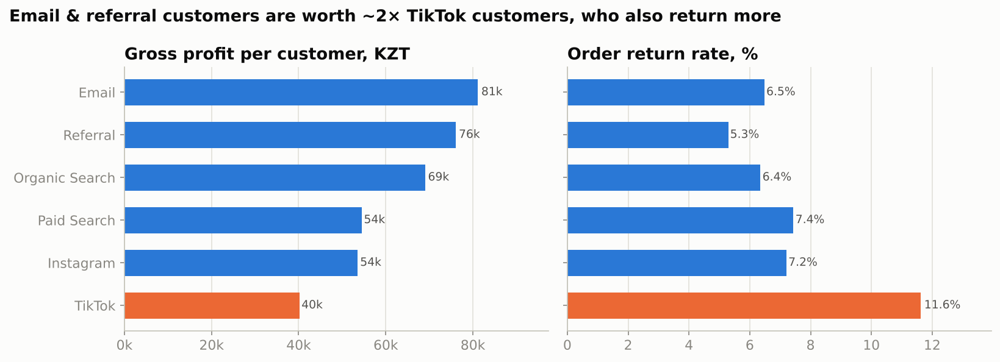
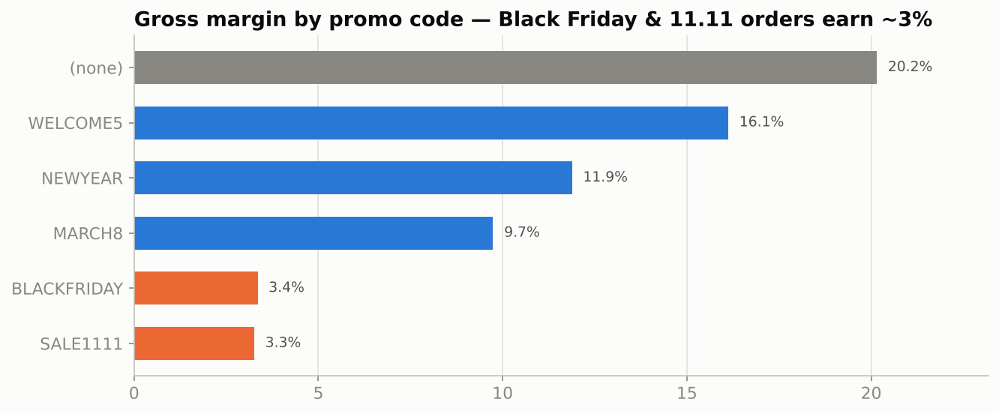
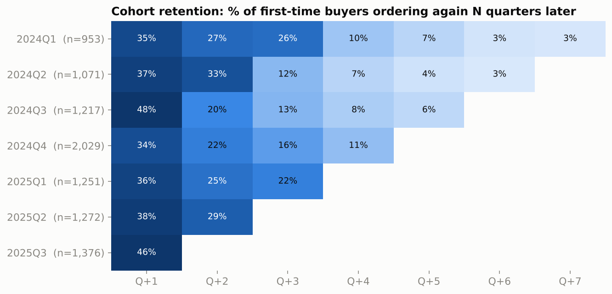
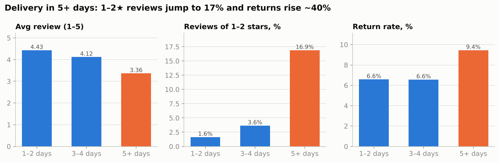

# 🛒 Dala Market — E-commerce Sales Analysis

End-to-end data analysis of a Kazakhstan online electronics store (2024–2025):
**data cleaning → SQL → Python analysis → Excel report → Power BI model → interactive dashboard.**



**▶ Live dashboard:** `dashboard/index.html` (enable GitHub Pages to get a public link — see below)

---

## Business questions

Dala Market launched in January 2024. After two years management wants to know:

1. How fast is the business growing, and how much depends on promo seasons?
2. Which acquisition channels bring **valuable** customers — not just first orders?
3. Which categories actually make money after discounts, costs and returns?
4. Where are we losing customers — delivery, returns, discounts?

## Key findings

| # | Finding | Recommendation |
|---|---------|----------------|
| 1 | Revenue **+53% YoY** to **2.49 bn KZT**, driven by +54% more buyers. AOV slipped −2%. YoY growth is slowing from +100–200% (early 2025) to **+17–32%** in Q4 | Next growth must come from retention and AOV: bundles, accessory cross-sell |
| 2 | **Nov–Dec = 27–34%** of annual revenue (11.11, Black Friday, New Year) | Plan stock, couriers and support for Q4 from September |
| 3 | Smartphones + laptops = **62% of revenue but 39% of profit** (10–13% margin). Accessories earn 46% | Push high-margin categories in promos and at checkout |
| 4 | **Black Friday and 11.11 orders earn only ~3% gross margin** vs 20% at full price | Cap discount % by category margin; use bundles instead of % off on phones |
| 5 | Only **35–48%** of first-time buyers order again next quarter; ~10% after a year | 90-day post-purchase CRM flow |
| 6 | **"At Risk" RFM segment** (18% of customers, inactive > 1 year) holds **30% of revenue** | Personalised win-back campaign |
| 7 | Email/referral customers are worth **~2× TikTok customers**; TikTok return rate **11.6%** vs 5.3% | Evaluate channels on profit per customer (LTV), not first-order CAC |
| 8 | Delivery in **5+ days**: 1–2★ reviews jump from 1.6% to **17%**, returns +40%. Western cities (Aktau, Atyrau, Kyzylorda) wait 5–6 days | Regional courier partner / pickup points in the West (~15% of revenue) |

<p>






</p>

## What's in the repo

```
├── data/
│   ├── raw/                  # raw exports (with real-world data-quality problems)
│   └── processed/            # cleaned CSVs + SQLite database dala_market.db
├── sql/
│   ├── 01_schema.sql         # tables, keys, indexes, v_sales view
│   ├── 02_kpis.sql           # KPIs, MoM/YoY growth (window functions)
│   ├── 03_customers_cohorts.sql   # repeat rate, cohort retention, channel quality (CTEs)
│   ├── 04_rfm_segmentation.sql    # RFM scoring with NTILE
│   ├── 05_products_operations.sql # categories, cities, delivery, promo margin
│   └── results/              # every query's output as CSV
├── notebooks/
│   └── sales_analysis.ipynb  # full analysis with charts and conclusions
├── excel/
│   └── dala_market_sales_report.xlsx  # live-formula report (SUMIFS/COUNTIFS) + charts
├── powerbi/
│   ├── model/                # star schema: fact_sales + 4 dimensions
│   ├── measures.dax          # 26 DAX measures incl. time intelligence
│   └── README.md             # Power BI / Tableau build guide
├── dashboard/
│   └── index.html            # interactive dashboard (vanilla JS + SVG, no dependencies)
├── images/                   # charts used in this README
└── scripts/                  # reproducible pipeline
```

## Skills demonstrated

- **Data cleaning (pandas):** duplicates, inconsistent categorical values (`Nur-Sultan` → `Astana`, `almaty` → `Almaty`), missing values, impossible birth years, referential-integrity checks
- **SQL:** schema design, joins, CTEs, window functions (`LAG`, `NTILE`, `SUM() OVER`), cohort analysis, RFM segmentation
- **Analysis:** growth & seasonality, unit economics (margin, AOV, profit per customer), cohort retention, RFM, operational drivers of satisfaction
- **Visualisation:** matplotlib charts with an accessible, colour-blind-safe palette; interactive dashboard with filters, tooltips and table view
- **BI:** star-schema modelling, DAX measures (time intelligence, ranking, shares), Tableau calculated fields
- **Excel:** formula-driven report, structured tables, charts, built-in reconciliation check
- **Communication:** findings tied to concrete business recommendations

## Data

The dataset is **synthetic**, generated by `scripts/generate_data.py` (fixed seed → fully reproducible),
and modelled on real e-commerce behaviour: seasonality (11.11, Black Friday, New Year, 8 March,
back-to-school), regional delivery times across 12 Kazakhstan cities, channel-dependent loyalty and
return rates, discount campaigns, and deliberately messy raw files.

| Table | Rows | Description |
|---|---|---|
| customers | 12,000 | city, gender, birth year, acquisition channel, signup date |
| products | 160 | 8 categories, 30 brands, price & cost (KZT) |
| orders | 26,341 | date, status (delivered / returned / cancelled), payment, promo code, delivery days, review |
| order_items | 40,448 | product, quantity, price, discount |

**Revenue definition:** net revenue (after discounts) of delivered orders, in KZT.

## How to reproduce

```bash
pip install -r requirements.txt
python scripts/generate_data.py      # 1. raw data
python scripts/clean_data.py         # 2. clean data + SQLite DB
python scripts/run_sql.py            # 3. run all SQL queries -> sql/results/
jupyter nbconvert --to notebook --execute --inplace notebooks/sales_analysis.ipynb   # 4. analysis + charts
python scripts/build_excel_report.py # 5. Excel report
python scripts/build_powerbi_model.py  # 6. Power BI star schema
python scripts/build_dashboard.py    # 7. interactive dashboard
```

Or simply run `bash run_all.sh`.

### Publish the dashboard with GitHub Pages
Repo **Settings ▸ Pages ▸ Deploy from a branch ▸ `main` / root** → the dashboard is live at
`https://<your-username>.github.io/<repo-name>/dashboard/`.

---

**Author:** Medet Makhambetkhan · Data Analyst
